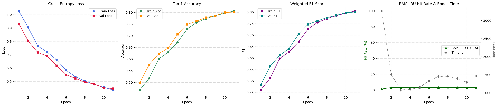

# 👁️‍🗨️ Visual Question Answering (VQA) - Nghiên cứu Khoa học (NCKH)

Dự án nghiên cứu và thực nghiệm các kiến trúc học sâu cho bài toán **Visual Question Answering (VQA)** trên tập dữ liệu suy luận tổng hợp quy mô lớn (`nckh-vqa`: CLEVR & CLOSURE), từ các mô hình baseline truyền thống đến **Thực nghiệm C: Frozen CLIP ViT-B/16 + Token-Level Cross-Attention**.

---

## 📑 Mục lục
1. [Tổng quan Thực nghiệm](#-tổng-quan-thực-nghiệm)
2. [Kết quả Đạt được (Thực nghiệm C)](#-kết-quả-đạt-được-thực-nghiệm-c)
3. [Kiến trúc các Mô hình](#-kiến-trúc-các-mô-hình)
4. [Cấu trúc Thư mục Dự án](#-cấu-trúc-thư-mục-dự-án)
5. [Cài đặt Môi trường](#-cài-đặt-môi-trường)
6. [Hướng dẫn Sử dụng & Tái lập](#-hướng-dẫn-sử-dụng--tái-lập)
7. [Tài liệu Đặc tả Kỹ thuật](#-tài-liệu-đặc-tả-kỹ-thuật)

---

## 📌 Tổng quan Thực nghiệm

Bài toán VQA nhận đầu vào gồm hình ảnh $I$ và câu hỏi văn bản $Q$, dự đoán câu trả lời chính xác $\hat{A}$ trong tập $28$ nhãn chuẩn hóa (`ans_vocab_train_only.pth`):

$$\hat{A} = \arg\max_{a \in \mathcal{A}} P(a \mid I, Q; \theta)$$

Notebook chính [vqa-reseach.ipynb](vqa-reseach.ipynb) triển khai hoàn chỉnh **Thực nghiệm C** (đồng thời bảo tồn các lớp baseline cũ để đối chiếu):
- **Backbone đóng băng hoàn toàn**: `openai/clip-vit-base-patch16` (`CLIPVisionModel` trích xuất 196 patch tokens bỏ `[CLS]`; `CLIPTextModel` + `CLIPTokenizerFast` trích xuất chuỗi token embeddings kèm mặt nạ padding).
- **Hợp nhất đa phương thức mức token (`CLIPTokenCrossAttentionVQA`)**: 2 tầng Question-to-Image Cross-Attention (8 heads, $d_{\text{model}} = 256$, Residual + LayerNorm + FFN $1024$) $\rightarrow$ Masked Mean Pooling $\rightarrow$ MLP Classifier (`~2.05M` tham số trainable).
- **Tối ưu 0 GB Disk Cache cho Kaggle**: Sử dụng **Image-Grouped Batching** (`ImageGroupedBatchSampler`) + **Khử trùng lặp ảnh trong batch** (`BatchCLIPFeatureExtractor`) + **RAM LRU Cache FP16** (`InMemoryImageFeatureLRU`), giải quyết triệt để giới hạn ổ đĩa 20 GB của `/kaggle/working` và chỉ tiêu thụ **~829 MB VRAM** trên Tesla T4.

---

## 🏆 Kết quả Đạt được (Thực nghiệm C)

Huấn luyện trên **Kaggle NVIDIA Tesla T4** (dừng ở **Epoch 11/30**, mô hình vẫn đang tiếp tục hội tụ tốt):

| Chỉ số | Tập Validation (Epoch 11) | Tập Test (Chính thức) | Ghi chú |
| :--- | :---: | :---: | :--- |
| **Top-1 Accuracy (CLEVR)** | `0.8014` (`80.14%`) | **`0.8000`** (`80.00%`) | Chỉ train `~2.05M` tham số trên CLIP đóng băng |
| **Weighted F1-Score** | `0.8004` | — | Đánh giá trên `139,999` mẫu validation |
| **CLOSURE Accuracy** | — | **`0.6099`** (`60.99%`) | Đánh giá tổng quát hóa tổ hợp câu hỏi mới |
| **H-MEAN** | — | **`0.6921`** (`69.211/100`) | Trung bình điều hòa CLEVR & CLOSURE |
| **Peak GPU VRAM** | `829.0 MB` | — | AMP FP16 + Frozen CLIP (`torch.no_grad`) |



> Xem phân tích chi tiết số liệu từng epoch và cơ sở toán học tại [docs/spec.md](docs/spec.md).

---

## 🧱 Kiến trúc các Mô hình

### 1. Baseline 1: `Model_ResNet_LSTM` (Tham chiếu)
- ResNet-18 (ImageNet1K) $\rightarrow$ Global Average Pooling (`512`) ghép nối với Embedding + LSTM (`256`) $\rightarrow$ MLP Classifier.

### 2. Baseline 2: `Model_ViT_Cross_attn` (Tham chiếu)
- ViT-B/16 (fine-tune 4 tầng cuối) + từ điển câu hỏi tự xây qua 4 tầng Transformer Encoder + 1 tầng Cross-Attention lấy token `[CLS]`.

### 3. Thực nghiệm C: `CLIPTokenCrossAttentionVQA` (Chính)
```text
[Hình ảnh 224x224] ──► Frozen CLIP Vision (bỏ CLS) ──► [B, 196, 768] ─► Linear(768→256) = K, V ─┐
                                                                                                   ├─► 2× Cross-Attention ─► Masked Mean Pool ─► MLP ─► Logits (28)
[Câu hỏi] ───────────► Frozen CLIP Text + Mask ─────► [B, L, 512]   ─► Linear(512→256) = Q ─────┘
```

---

## 📂 Cấu trúc Thư mục Dự án

```text
VQA - NCKH/
├── vqa-reseach.ipynb                 # Notebook chính (18 mục, Kiểu 2: On-the-fly + RAM LRU)
├── requirements.txt                  # Thư viện phụ thuộc (PyTorch, Transformers, scikit-learn...)
├── README.md                         # Tài liệu tổng quan dự án
├── .gitignore                        # Bỏ qua dữ liệu zip/cache lớn khi push GitHub
├── docs/
│   └── spec.md                       # Đặc tả kỹ thuật & phân tích kết quả chi tiết
├── checkpoints/
│   ├── best_clip_crossattn.pth       # Checkpoint tốt nhất Epoch 11 (Val Acc = 0.8014)
│   └── ans_vocab_train_only.pth      # Từ điển 28 nhãn câu trả lời (dựng chỉ từ tập train)
└── outputs/
    ├── clip_crossattn_history.json   # Lịch sử huấn luyện Epoch 1–11
    └── clip_crossattn_history.png    # Biểu đồ Loss / Accuracy / F1 / RAM LRU Hit Rate
```

*(Tệp dữ liệu gốc như `nckh-vqa.zip` được loại trừ tự động bởi `.gitignore` để giữ repository nhẹ gọn khi đẩy lên GitHub.)*

---

## ⚙️ Cài đặt Môi trường

```powershell
# Tạo và kích hoạt môi trường ảo (Windows PowerShell)
python -m venv .venv
.venv\Scripts\Activate.ps1

# Cài đặt PyTorch (chọn phiên bản CUDA phù hợp hoặc CPU)
pip install torch torchvision --index-url https://download.pytorch.org/whl/cu121

# Cài đặt các thư viện còn lại
pip install -r requirements.txt
```

---

## 🚀 Hướng dẫn Sử dụng & Tái lập

### 1. Chạy trên Kaggle (Khuyến nghị — GPU T4)
1. Upload [vqa-reseach.ipynb](vqa-reseach.ipynb) lên Kaggle, bật **GPU T4** và **Internet ON**, gắn dataset `lbophc/nckh-vqa`.
2. Giữ `Config.DEBUG_MODE = True` để chạy kiểm thử nhanh (`64` train / `32` val / `32` test).
3. Đổi `Config.DEBUG_MODE = False` ở cell **Mục 3** và chọn **Run All** để huấn luyện đầy đủ và sinh `/kaggle/working/submission.csv` + `/kaggle/working/submission.zip`.

### 2. Chạy Suy luận / Đánh giá lại từ Checkpoint có sẵn
- Checkpoint đã huấn luyện được lưu tại [checkpoints/best_clip_crossattn.pth](checkpoints/best_clip_crossattn.pth) kèm từ điển nhãn [checkpoints/ans_vocab_train_only.pth](checkpoints/ans_vocab_train_only.pth).
- Có thể chạy thẳng hàm `evaluate_checkpoint_on_validation()` (Mục 14) hoặc `inference()` (Mục 17) sau khi chạy các cell cấu hình & nạp dữ liệu.

---

## 📄 Tài liệu Đặc tả Kỹ thuật

Chi tiết đầy đủ về kiến trúc toán học, cơ chế khử trùng lặp ảnh trong bộ nhớ, phân tích từng epoch và định hướng mở rộng (**Thực nghiệm D**) được trình bày tại:
- 👉 [docs/spec.md](docs/spec.md)
