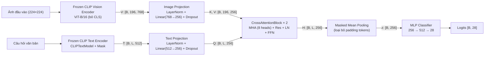

# Đặc tả Kỹ thuật Thực nghiệm C: Frozen CLIP + Token-Level Cross-Attention cho VQA

Tài liệu này mô tả chi tiết phương pháp, kiến trúc mô hình, cơ chế tối ưu bộ nhớ (Zero-Disk On-the-Fly + RAM LRU Cache) và kết quả thực nghiệm của **Thực nghiệm C** trong đề tài Nghiên cứu Khoa học (NCKH) **Visual Question Answering (VQA)**.

---

## 1. Mục tiêu Nghiên cứu (Research Objective)

Thực nghiệm C khảo sát câu hỏi nghiên cứu cốt lõi:

> **Liệu các biểu diễn đặc trưng mức token từ mô hình nền tảng đa phương thức CLIP đóng băng (`openai/clip-vit-base-patch16`) kết hợp với cơ chế Question-to-Image Cross-Attention gọn nhẹ (~2.05M tham số huấn luyện) có thể giải quyết hiệu quả bài toán VQA suy luận tổng hợp (CLEVR & CLOSURE) mà không cần fine-tune backbone hay không?**

### Động lực thiết kế
1. **Bảo toàn thông tin cục bộ mức token**: Thay vì chỉ dùng vector gộp toàn cục (*pooled vector*) vốn làm mất vị trí không gian và chi tiết từng từ khóa trong câu hỏi dài, kiến trúc giữ lại toàn bộ **196 patch tokens** ($14 \times 14$) của ảnh và **chuỗi token hidden states** của câu hỏi.
2. **Tách biệt hoàn toàn phần đóng băng và phần học**: Đóng băng 100% CLIP Vision & Text Encoders (`requires_grad = False`, chế độ `eval()`), chỉ huấn luyện khối chiếu, Cross-Attention và bộ phân loại để đánh giá công bằng năng lực của biểu diễn tiền huấn luyện CLIP.

---

## 2. Đặc tả Dữ liệu (`nckh-vqa`)

Bộ dữ liệu gồm các câu hỏi VQA suy luận tổng hợp (nguồn CLEVR & CLOSURE), được tổ chức chuẩn hóa trong [vqa-reseach.ipynb](../vqa-reseach.ipynb):

| Tập dữ liệu | Tệp JSON | Cấu trúc JSON | Thư mục ảnh | Số câu hỏi | Số ảnh duy nhất | Nhãn (`answer`) |
| :--- | :--- | :--- | :--- | :---: | :---: | :---: |
| **Train** | `questions/train.json` | `data["root"]["questions"]` | `images/train/` | `559,990` | `56,000` | Có (`28` lớp) |
| **Validation** | `questions/val.json` | `data["root"]["questions"]` | `images/train/` | `139,999` | `14,000` | Có (`28` lớp) |
| **Test** | `questions/test.json` | `data["questions"]` | `images/test/` | `227,899` | `15,000` | Không (`qid` ẩn nhãn) |

### Không gian nhãn câu trả lời (`checkpoints/ans_vocab_train_only.pth`)
Từ điển câu trả lời được xác thực và xây dựng **duy nhất từ tập train** (`28` lớp, chỉ số `0..27`) nhằm đảm bảo không rò rỉ nhãn (*answer leakage*) từ tập validation/test:
- **Số lượng (`0`–`10`)**: `11` lớp
- **Màu sắc (`blue`, `brown`, `cyan`, `gray`, `green`, `purple`, `red`, `yellow`)**: `8` lớp
- **Hình dạng (`cube`, `cylinder`, `sphere`)**: `3` lớp
- **Kích thước (`large`, `small`)**: `2` lớp
- **Chất liệu (`metal`, `rubber`)**: `2` lớp
- **Nhị phân (`yes`, `no`)**: `2` lớp

---

## 3. Kiến trúc Mô hình (`CLIPTokenCrossAttentionVQA`)

### 3.1. Luồng xử lý tổng thể

### 3.2. Công thức chi tiết từng thành phần

1. **Frozen Encoders (`openai/clip-vit-base-patch16`)**:
   - **Vision**: Với ảnh đã chuẩn hóa bởi `CLIPImageProcessor`, trích xuất hidden states tầng cuối và loại bỏ token `[CLS]` ở chỉ số `0`:
     $$V = \text{CLIPVision}(I)_{[:, 1:, :]} \in \mathbb{R}^{B \times 196 \times 768}$$
   - **Text**: Tokenize bằng `CLIPTokenizerFast` (tối đa $L_{\max} = 77$), thu được chuỗi ẩn từng token và mặt nạ hợp lệ $M \in \{0, 1\}^{B \times L}$:
     $$T = \text{CLIPText}(Q) \in \mathbb{R}^{B \times L \times 512}$$

2. **Chiếu sang không gian chung ($d_{\text{model}} = 256$)**:
   $$Q^{(0)} = \text{Dropout}\big(W_t\,\text{LN}(T) + b_t\big) \odot M \in \mathbb{R}^{B \times L \times 256}$$
   $$K = V_{\text{proj}} = \text{Dropout}\big(W_v\,\text{LN}(V) + b_v\big) \in \mathbb{R}^{B \times 196 \times 256}$$

3. **Khối Cross-Attention nhiều tầng (`NUM_CROSS_LAYERS = 2`, `NUM_HEADS = 8`)**:
   Tại mỗi tầng $\ell \in \{1, 2\}$, câu hỏi đóng vai trò **Query**, các patch ảnh đóng vai trò **Key & Value**:
   $$\tilde{Q}^{(\ell)} = \text{LN}\Big(Q^{(\ell-1)} + \text{Dropout}\big(\text{MHA}(Q^{(\ell-1)}, K, V_{\text{proj}})\big)\Big)$$
   $$Q^{(\ell)} = \text{LN}\Big(\tilde{Q}^{(\ell)} + \text{Dropout}\big(\text{FFN}(\tilde{Q}^{(\ell)})\big)\Big) \odot M$$
   trong đó $\text{FFN}(x) = W_2\,\text{GELU}(W_1 x + b_1) + b_2$ với chiều ẩn `FFN_DIM = 1024`, `DROPOUT = 0.1`. Việc nhân lại với mặt nạ $M$ sau mỗi tầng ngăn hoàn toàn giá trị tại các vị trí padding ảnh hưởng tới bước gộp phía sau.

4. **Masked Mean Pooling & Bộ phân loại MLP**:
   $$z = \frac{\sum_{l=1}^{L} M_{b,l}\,\text{LN}\big(Q^{(2)}_{b,l}\big)}{\max\big(\sum_{l=1}^{L} M_{b,l},\, 10^{-6}\big)} \in \mathbb{R}^{B \times 256}$$
   $$\hat{y} = W_{c2}\,\text{Dropout}\Big(\text{GELU}\big(\text{LN}(W_{c1} z + b_{c1})\big)\Big) + b_{c2} \in \mathbb{R}^{B \times 28}$$
   - Tổng số tham số huấn luyện của `CLIPTokenCrossAttentionVQA`: **`2,045,957` tham số** (`~2.05M`), tối ưu với `CrossEntropyLoss`.

---

## 4. Tối ưu Hệ thống & Bộ nhớ (Zero-Disk On-the-Fly + RAM LRU Cache)

### 4.1. Vấn đề lưu trữ Cache ngoại tuyến trên Kaggle
Lưu toàn bộ token embeddings mức patch ở định dạng `FP16` trên tập dữ liệu đầy đủ đòi hỏi dung lượng đĩa rất lớn:
- Ảnh (`85,000` ảnh $\times 196 \times 768 \times 2$ bytes) $\approx 23.83\text{ GiB}$
- Câu hỏi (`927,888` câu $\times L \times 512 \times 2$ bytes) $\approx 45$–$52\text{ GiB}$
- Tổng cộng **~70–80 GiB**, vượt quá giới hạn **20 GB** của thư mục `/kaggle/working/` trên Kaggle.

### 4.2. Giải pháp kiến trúc dữ liệu (Option 2)
Để đạt **0 MB cache trên ổ đĩa** mà vẫn giữ tốc độ cao trên **Tesla T4 (16 GB VRAM)**:
1. **`ImageGroupedBatchSampler`**: Ở mỗi epoch, thuật toán xáo trộn ngẫu nhiên thứ tự các ảnh duy nhất rồi xếp các câu hỏi cùng một ảnh vào chung batch (trung bình ~10 câu hỏi/ảnh $\rightarrow$ mỗi batch `64` câu hỏi chỉ chứa ~`6–8` ảnh duy nhất).
2. **`BatchCLIPFeatureExtractor` (Khử trùng lặp trong batch)**: Trong một batch `64` câu hỏi, `CLIPVisionModel` chỉ cần chạy **1 lần cho mỗi ảnh duy nhất** chưa có trong cache (giảm ~90% số lần chạy ViT ngay cả khi RAM cache nguội), thực hiện đọc ảnh song song qua `ThreadPoolExecutor` và suy luận dưới `torch.no_grad()` + CUDA AMP (`float16`).
3. **`InMemoryImageFeatureLRU` (RAM LRU Cache)**: Tự động giới hạn theo dung lượng RAM trống (tối đa `12.0 GB` trên Kaggle $\approx 42,800$ ảnh `FP16`), giúp các ảnh hit trong RAM không cần đọc lại từ đĩa hay chạy lại ViT.
4. **Chi phí VRAM thực tế**: Đỉnh bộ nhớ GPU khi huấn luyện trên Tesla T4 chỉ tiêu thụ **`~829.2 MB` VRAM** trên 16 GB.

---

## 5. Cấu hình Huấn luyện & Kết quả Thực nghiệm

### 5.1. Siêu tham số huấn luyện
- **Optimizer**: `AdamW` (`lr = 3e-4`, `weight_decay = 0.01`), chỉ cập nhật `2,045,957` tham số của module Cross-Attention & Classifier.
- **Scheduler**: `LinearLR` warmup (`10%` số epoch đầu, khởi điểm `0.2 × lr`) kết hợp `CosineAnnealingLR` (tính theo `EPOCHS = 30`).
- **Regularization & Precision**: Gradient clipping (`max_norm = 1.0`), CUDA Mixed Precision (`torch.amp.autocast('cuda')` + `GradScaler`), `BATCH_SIZE = 64`, `SEED = 42`.
- **Tiêu chí lưu model tốt nhất**: Validation Accuracy cao nhất (Validation Loss thấp hơn làm tie-breaker).

### 5.2. Tiến trình huấn luyện thực tế (Epoch 1 – Epoch 11, Kaggle Tesla T4)

Dữ liệu trích xuất trực tiếp từ checkpoint [best_clip_crossattn.pth](../checkpoints/best_clip_crossattn.pth) và lưu tại [clip_crossattn_history.json](../outputs/clip_crossattn_history.json):

| Epoch | Train Loss | Train Acc | Train F1 | Val Loss | Val Acc | Val F1 | LR | Thời gian (s) | Peak VRAM (MB) |
| :---: | :---: | :---: | :---: | :---: | :---: | :---: | :---: | :---: | :---: |
| 1 | 1.0279 | 0.4675 | 0.4615 | 0.9333 | 0.4974 | 0.4829 | 6.00e-05 | 3267.7 | 829.5 |
| 2 | 0.9042 | 0.5180 | 0.5137 | 0.8025 | 0.5766 | 0.5649 | 1.40e-04 | 1516.8 | 829.2 |
| 3 | 0.7660 | 0.6009 | 0.5986 | 0.7179 | 0.6229 | 0.6126 | 2.20e-04 | 1078.6 | 829.2 |
| 4 | 0.7208 | 0.6290 | 0.6272 | 0.6912 | 0.6470 | 0.6416 | 3.00e-04 | 1101.3 | 829.4 |
| 5 | 0.6629 | 0.6723 | 0.6706 | 0.6197 | 0.7060 | 0.7048 | 2.99e-04 | 1150.6 | 829.2 |
| 6 | 0.5851 | 0.7284 | 0.7268 | 0.5522 | 0.7489 | 0.7471 | 2.96e-04 | 1331.2 | 829.4 |
| 7 | 0.5361 | 0.7570 | 0.7555 | 0.5236 | 0.7626 | 0.7625 | 2.91e-04 | 1456.6 | 829.2 |
| 8 | 0.5042 | 0.7734 | 0.7721 | 0.4951 | 0.7782 | 0.7764 | 2.84e-04 | 1459.1 | 829.2 |
| 9 | 0.4793 | 0.7862 | 0.7850 | 0.4817 | 0.7865 | 0.7861 | 2.76e-04 | 1402.1 | 829.4 |
| 10 | 0.4574 | 0.7970 | 0.7959 | 0.4527 | 0.8001 | 0.7981 | 2.65e-04 | 1294.0 | 829.2 |
| **11** | **0.4363** | **0.8067** | **0.8056** | **0.4478** | **0.8014** | **0.8004** | 2.53e-04 | 1470.0 | **829.0** |

### 5.3. Kết quả đánh giá trên tập Test (Checkpoint Epoch 11)

| Chỉ số đánh giá | Giá trị | Ý nghĩa khoa học |
| :--- | :---: | :--- |
| **Validation Accuracy** | **0.8014** | Liên tục cải thiện qua cả 11 epochs, chưa có dấu hiệu overfitting (`Train Acc = 0.8067`). |
| **Validation Weighted F1** | **0.8004** | Cân bằng ổn định trên cả 28 lớp câu trả lời. |
| **Test — CLEVR Accuracy** | **0.8000** | Đạt 80.00% trên phân bố chuẩn dù chỉ huấn luyện ~2.05M tham số trên CLIP đóng băng và dừng ở epoch 11/30. |
| **Test — CLOSURE Accuracy** | **0.6099** | Duy trì 60.99% trên các tổ hợp câu hỏi mới chưa thấy trong tập train nhờ biểu diễn ngữ nghĩa của CLIP Text Encoder. |
| **Test — H-MEAN** | **0.6921** | Trung bình điều hòa giữa CLEVR và CLOSURE (`69.211 / 100`). |

---

## 6. Phân tích Giới hạn & Hướng Phát triển (Thực nghiệm D)

1. **Nguyên nhân khoảng cách giữa CLEVR (`80.00%`) và CLOSURE (`60.99%`)**:
   - Frozen CLIP không được huấn luyện chuyên biệt cho suy luận quan hệ không gian nhiều bước (*left of*, *behind*, *same size*) và đếm vật thể nhỏ (`tiny`) ở độ phân giải `224×224`.
   - Khối hợp nhất hiện chỉ có 2 tầng Cross-Attention một chiều (`Question → Image`) kết hợp `Masked Mean Pooling` nên khi gặp cấu trúc tham chiếu lồng nhau mới ở CLOSURE, vector trung bình dễ mất thông tin thứ tự bước suy luận.
2. **Tối ưu RAM Cache khi `70,000` ảnh vượt `12 GB` RAM**:
   - Vì `train + val = 70,000` ảnh (`~20.1 GB`) lớn hơn `12 GB` (`~42,800` ảnh), LRU bị đẩy vòng cuối mỗi epoch (hit rate cross-epoch ~3.1–3.4%, dù khử trùng lặp trong batch vẫn giảm ~90% chi phí ViT). Có thể cải thiện ở phiên bản tiếp theo bằng **Pinned Static RAM Cache** (ghim cố định ~40,000 ảnh train đầu mà không đẩy ra khi chạy validation).
3. **Đề xuất cho Thực nghiệm D**:
   - Cộng **2D Positional Embedding** cho lưới patch $14 \times 14$ trước khi vào Cross-Attention.
   - Bổ sung **Self-Attention / Co-Attention** trên chuỗi token sau hợp nhất thay cho gộp trung bình đơn thuần.
   - Thử nghiệm backbone độ phân giải cao hơn (`SigLIP / SigLIP 2` hoặc `CLIP-ViT-L/14@336px`).
